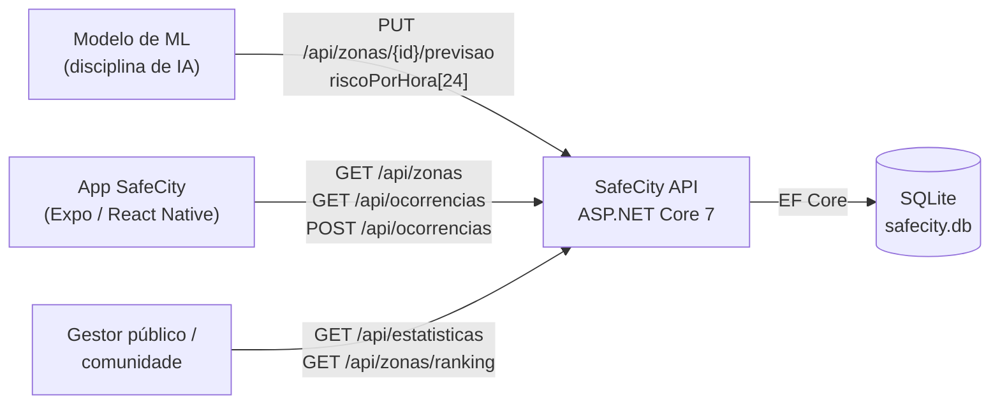
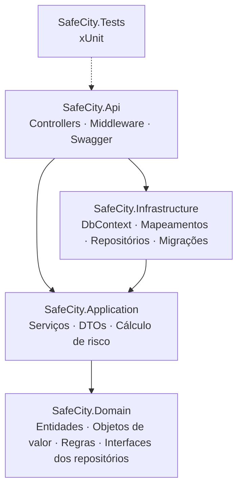
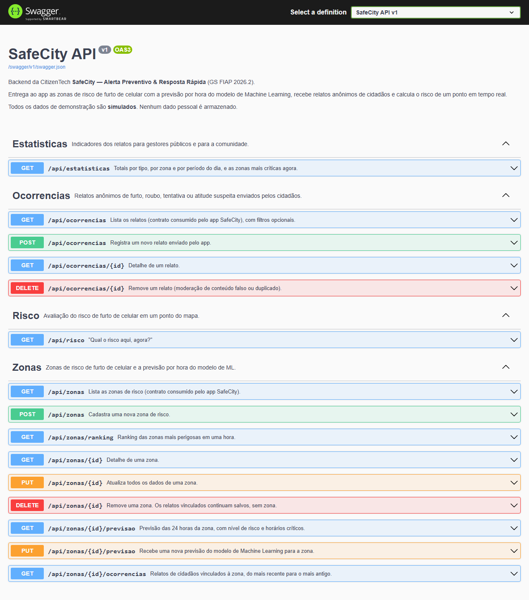
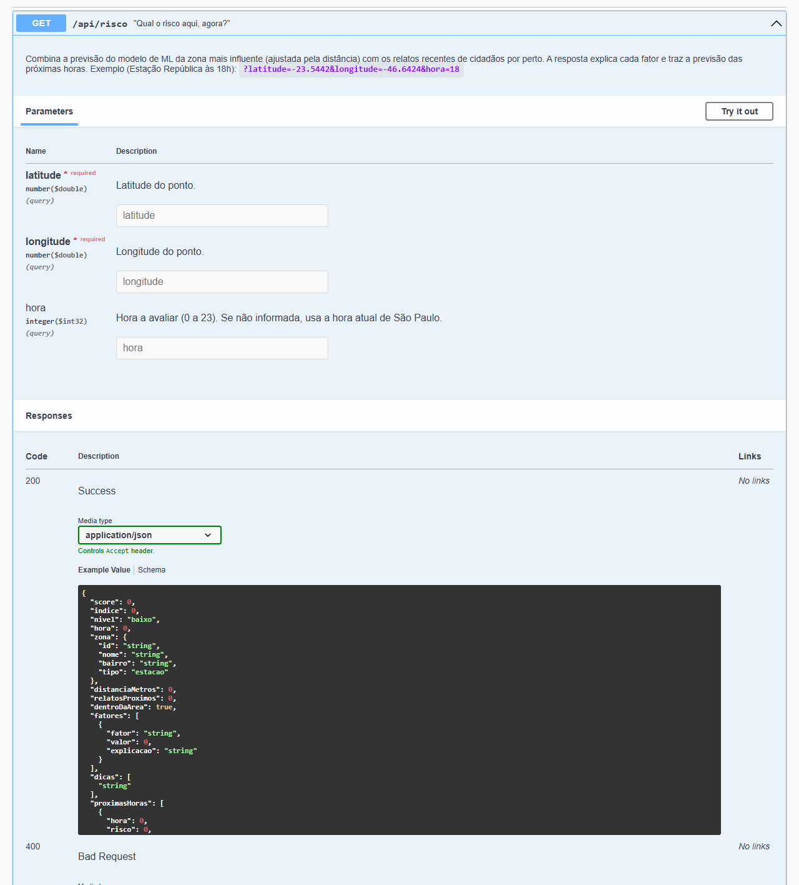
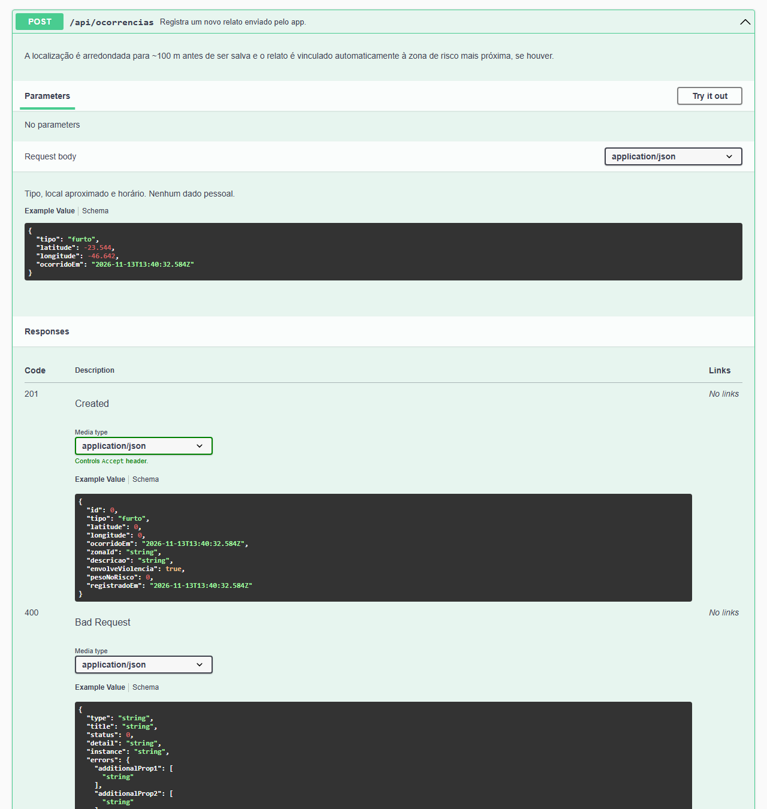
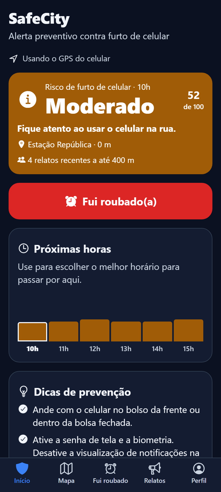
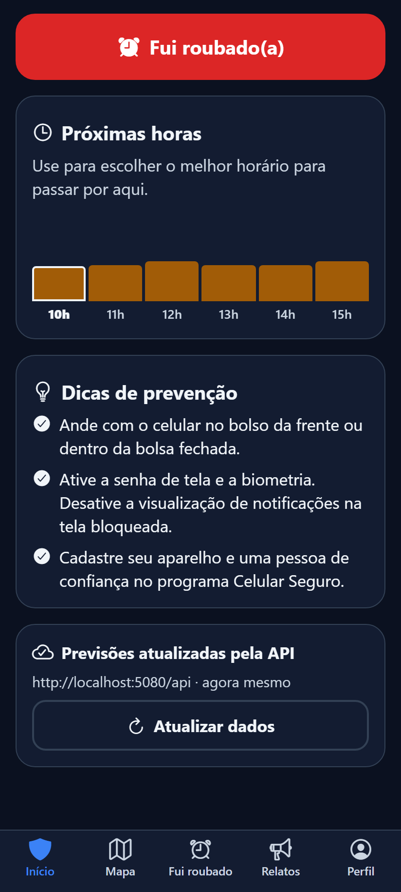
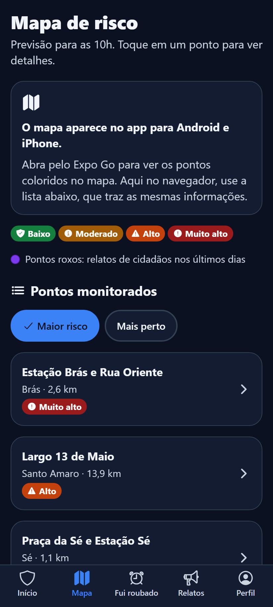

# SafeCity API — Alerta Preventivo & Resposta Rápida

Backend em **C# / .NET (ASP.NET Core Web API + Entity Framework Core)** da CitizenTech **SafeCity**,
desenvolvido para a Global Solution FIAP 2026.2 — disciplina **C# Software Development**.

> Entrega ao app as zonas da cidade com maior risco de furto de celular, com a previsão por hora do
> modelo de Machine Learning; recebe relatos anônimos dos cidadãos; e responde, para qualquer ponto
> do mapa, **"qual o risco aqui, agora?"** — explicando o porquê.

---

## Ficha da CitizenTech

| Item | Resposta |
| --- | --- |
| **Nome** | SafeCity — Alerta Preventivo & Resposta Rápida |
| **Cidade e bairro** | São Paulo – SP · centro expandido (Sé, República, Luz, Brás, Av. Paulista/Consolação, Pinheiros, Santo Amaro) |
| **Cidadão beneficiado** | Trabalhador, estudante ou cidadão comum que anda a pé ou de transporte público e precisa usar o celular na rua |
| **Problema, em uma frase** | Quem circula a pé ou de transporte público não sabe onde e quando o risco de ter o celular furtado é maior e, quando o furto acontece, perde os minutos decisivos sem saber o que bloquear primeiro. |
| **Como funciona** | O app usa a localização (só no aparelho) e a previsão de risco por hora gerada pelo modelo de Machine Learning para emitir **alertas preventivos**. Se o furto acontecer, o botão **"Fui roubado(a)"** abre a **Hora de Ouro**, um guia passo a passo. Cidadãos registram **relatos** anônimos que aumentam o risco do local em tempo real. |
| **O que cada parte faz** | **C# (este repositório):** API REST que guarda as zonas e a previsão do modelo, recebe os relatos, vincula cada relato à zona mais próxima, calcula o risco de um ponto e gera indicadores. **Mobile:** app do cidadão que consome esta API (`/zonas` e `/ocorrencias`). **IA & ML:** treina o modelo com dados públicos da SSP-SP e publica o `riscoPorHora` de cada zona (`PUT /api/zonas/{id}/previsao`). *Demais disciplinas: a equipe completa aqui.* |
| **Link do repositório** | https://github.com/AndreyRNagata/safecity-api |
| **Indicador de impacto** | **Tempo até concluir os 3 passos críticos** da Hora de Ouro (meta: menos de 15 min), medido no app. Nesta API: relatos recebidos por zona e por período do dia e zonas mais críticas agora (`GET /api/estatisticas`), para orientar o cidadão e o poder público. |
| **ODS conectados** | **ODS 11** (11.2 transporte seguro e 11.7 espaços públicos seguros), **ODS 16** (16.1 reduzir a violência) e **ODS 9** (9.c acesso à tecnologia da informação) |

### Integrantes

| Nome | RM |
| --- | --- |
| Andrey Rodrigues Nagata | RM555339 |
| Henrique Soubhia | RM554493 |
| Oliver Kanai Trindade | RM554954 |
| Pedro Gutierre Cardoso de Oliveira | RM555445 |
| William Weile Feng | RM555132 |

---

## O que a API faz



1. **Zonas de risco** — estações, terminais, avenidas e praças com a previsão de risco para cada hora do
   dia (`riscoPorHora`, 24 valores de 0 a 1). O pipeline de IA atualiza a previsão pela API.
2. **Relatos** — o app envia furto, roubo, tentativa ou atitude suspeita **sem nenhum dado pessoal**.
   A API arredonda o local para ~100 m e vincula o relato à zona mais próxima.
3. **Risco agora** — combina a previsão do modelo (ajustada pela distância) com os relatos recentes
   por perto, devolve o nível (baixo → muito alto), **explica cada fator** e traz as próximas 6 horas.
4. **Indicadores** — totais por tipo, por zona e por período do dia, e as zonas mais críticas agora.

O contrato de `GET /zonas`, `GET /ocorrencias` e `POST /ocorrencias` é **o mesmo do mock usado pelo app
mobile**: basta apontar o app para esta API (veja [Conectar o app mobile](#conectar-o-app-mobile)).

---

## Como rodar

### Pré-requisitos

- [.NET SDK 7](https://dotnet.microsoft.com/download) ou mais novo (o projeto também roda com o .NET 8/9).
- Nada de banco para instalar: o **SQLite** é criado automaticamente.

### Passo a passo

```bash
git clone https://github.com/AndreyRNagata/safecity-api.git
```

```bash
cd safecity-api
```

```bash
dotnet run --project src/SafeCity.Api
```

Abra **http://localhost:5080/swagger**. Na primeira execução a API:

1. aplica as **migrações** do EF Core (cria o arquivo `safecity.db`);
2. carrega **14 zonas e 18 relatos simulados** (os mesmos dados do mock do app).

Para começar do zero, apague o arquivo `src/SafeCity.Api/safecity.db` e rode de novo.

### Testes

```bash
dotnet test
```

São **82 testes** (xUnit): domínio, cálculo de risco, serviços com SQLite em memória e a API inteira
com `WebApplicationFactory`. Resultado da última execução: [docs/evidencias/testes.txt](docs/evidencias/testes.txt).

### Requisições prontas

O arquivo [SafeCity.http](SafeCity.http) tem exemplos de todas as rotas para rodar direto no
Visual Studio, Rider ou VS Code (extensão REST Client).

### Conectar o app mobile

1. Suba a API aceitando conexões da rede (o celular não enxerga `localhost` do computador):

   ```bash
   dotnet run --project src/SafeCity.Api --launch-profile celular
   ```

2. No projeto do app, crie o `.env` com o IP do computador (celular e computador no mesmo Wi-Fi):

   ```
   EXPO_PUBLIC_API_URL=http://192.168.0.10:5080/api
   ```

3. Reinicie o Expo (`npx expo start -c`). A tela Início mostra **"Previsões atualizadas pela API"**.

A API libera CORS para o app (inclusive a versão web do Expo).

### Migrações (EF Core)

A migração inicial já está em [src/SafeCity.Infrastructure/Migrations](src/SafeCity.Infrastructure/Migrations)
e é aplicada sozinha ao subir a API. Para criar uma nova depois de mudar o modelo:

```bash
dotnet tool restore
```

```bash
dotnet ef migrations add NomeDaMudanca --project src/SafeCity.Infrastructure --startup-project src/SafeCity.Api --output-dir Migrations
```

### Problema comum no Windows: caminho muito longo

Se a compilação falhar com `MSB3030 ... não foi possível copiar o arquivo` ou `... already exists`,
a pasta do projeto está em um caminho com mais de 260 caracteres (comum dentro do OneDrive). Clone o
repositório em uma pasta curta, como `C:\dev\safecity-api`.

---

## Endpoints

Documentação completa e interativa no **Swagger**: http://localhost:5080/swagger

| Método | Rota | O que faz |
| --- | --- | --- |
| `GET` | `/api/zonas` | Lista as zonas (contrato do app). Filtros: `bairro`, `tipo` |
| `GET` | `/api/zonas/{id}` | Detalhe de uma zona |
| `GET` | `/api/zonas/{id}/previsao` | 24 horas com nível de risco, horário de pico e horários críticos ("7h–8h e 17h–19h") |
| `GET` | `/api/zonas/{id}/ocorrencias` | Relatos vinculados à zona |
| `GET` | `/api/zonas/ranking` | Zonas mais perigosas em uma hora (`hora`, `limite`) |
| `POST` | `/api/zonas` | Cadastra zona (201 + `Location`; 409 se o id já existe) |
| `PUT` | `/api/zonas/{id}` | Atualiza a zona |
| `PUT` | `/api/zonas/{id}/previsao` | Recebe nova previsão do modelo de ML |
| `DELETE` | `/api/zonas/{id}` | Remove a zona (os relatos ficam, sem zona) |
| `GET` | `/api/ocorrencias` | Lista relatos (contrato do app). Filtros: `tipo`, `zonaId`, `desde`, `latitude` + `longitude` + `raioMetros`, `limite` |
| `GET` | `/api/ocorrencias/{id}` | Detalhe de um relato |
| `POST` | `/api/ocorrencias` | Registra relato `{ tipo, latitude, longitude, ocorridoEm }` (contrato do app) |
| `DELETE` | `/api/ocorrencias/{id}` | Remove relato (moderação) |
| `GET` | `/api/risco` | Risco de um ponto: `latitude`, `longitude` e `hora` (opcional) |
| `GET` | `/api/estatisticas` | Indicadores dos últimos `dias` (padrão 30) |
| `GET` | `/health` | Verificação de saúde da API |

Erros seguem o padrão **ProblemDetails** (RFC 7807): `400` (validação ou regra de negócio),
`404` (não encontrado) e `409` (conflito). Exemplos reais em
[docs/evidencias/09-erros-tratados.txt](docs/evidencias/09-erros-tratados.txt).

---

## Arquitetura

Solução em camadas (inspirada na Clean Architecture). As dependências apontam sempre para dentro:
o **domínio** não conhece banco nem web.



```
src/
  SafeCity.Domain/            # Regras de negócio puras
    Comum/                    # Entidade base, exceções, validações (Guarda)
    ValueObjects/             # Coordenada, PrevisaoHoraria, AreaRetangular
    Zonas/                    # ZonaRisco, TipoLocal, LocalizadorDeZonas
    Ocorrencias/              # Ocorrencia (abstrata) + Furto, Roubo, Tentativa, AtitudeSuspeita + Factory
    Risco/                    # NivelRisco e ClassificadorRisco
    Repositorios/             # Interfaces IRepositorio<T, TId>, IZonaRepositorio, IOcorrenciaRepositorio
  SafeCity.Application/       # Casos de uso
    Servicos/                 # ZonaServico, OcorrenciaServico, RiscoServico, EstatisticaServico (+ interfaces)
    Risco/                    # IFatorRisco (Strategy), FatorPrevisaoModelo, FatorRelatosRecentes, CalculadoraRisco
    Dtos/ · Mapeamentos/      # Contratos da API e conversão entidade → DTO
  SafeCity.Infrastructure/    # Persistência
    Dados/                    # SafeCityDbContext, configurações Fluent API, conversores, seed
    Repositorios/             # RepositorioBase<T, TId> + repositórios concretos (LINQ)
    Migrations/               # Migração inicial
  SafeCity.Api/               # Web API
    Controllers/ · Middlewares/ · Configuracao/ · Program.cs
tests/
  SafeCity.Tests/             # Dominio/, Aplicacao/, Api/, Suporte/
docs/evidencias/              # Prints e respostas reais da API
```

---

## Onde está cada critério da disciplina

### POO — 3,0

| Conceito | Onde |
| --- | --- |
| **Encapsulamento** | Entidades com setters privados que só mudam por métodos que validam: [ZonaRisco](src/SafeCity.Domain/Zonas/ZonaRisco.cs) (`AtualizarDados`, `AtualizarPrevisao`), [Ocorrencia](src/SafeCity.Domain/Ocorrencias/Ocorrencia.cs). Previsão exposta só como leitura em [PrevisaoHoraria](src/SafeCity.Domain/ValueObjects/PrevisaoHoraria.cs). |
| **Herança** | `Entidade` → `Entidade<TId>` → `ZonaRisco` / `Ocorrencia` ([Entidade.cs](src/SafeCity.Domain/Comum/Entidade.cs)); `Ocorrencia` → `Furto`, `Roubo`, `Tentativa`, `AtitudeSuspeita` ([TiposDeOcorrencia.cs](src/SafeCity.Domain/Ocorrencias/TiposDeOcorrencia.cs)); `RepositorioBase<T, TId>` → repositórios concretos; `SafeCityException` → exceções específicas; `DadosZonaRequest` → `CriarZonaRequest`. |
| **Abstração** | Classe abstrata `Ocorrencia` com membros abstratos (`PesoNoRisco`, `EnvolveViolencia`, `Descricao`). |
| **Polimorfismo** | O peso de cada relato no risco vem da subclasse: roubo 1,5 · furto 1,0 · tentativa 0,75 · suspeita 0,5 ([FatorRelatosRecentes](src/SafeCity.Application/Risco/FatorRelatosRecentes.cs)). O middleware escolhe o status HTTP pelo tipo da exceção ([TratamentoDeErrosMiddleware](src/SafeCity.Api/Middlewares/TratamentoDeErrosMiddleware.cs)). |
| **Objetos de valor** | `Coordenada` (record imutável, Haversine), `PrevisaoHoraria` (igualdade por valor, `IEquatable`). |
| **Padrões de projeto** | **Factory** ([OcorrenciaFactory](src/SafeCity.Domain/Ocorrencias/OcorrenciaFactory.cs)), **Strategy** ([IFatorRisco](src/SafeCity.Application/Risco/IFatorRisco.cs)), **Repository** e **Unit of Work** ([IRepositorio.cs](src/SafeCity.Domain/Repositorios/IRepositorio.cs)), **Options** ([OpcoesRisco](src/SafeCity.Application/Risco/OpcoesRisco.cs)). |
| **Interfaces + Injeção de Dependência** | Serviços, repositórios, relógio (`IRelogio`) e fatores de risco são registrados no contêiner ([Application](src/SafeCity.Application/InjecaoDeDependencia.cs), [Infrastructure](src/SafeCity.Infrastructure/InjecaoDeDependencia.cs)). A `CalculadoraRisco` recebe `IEnumerable<IFatorRisco>`: um critério novo entra sem mexer nela (há teste provando isso). |

### Web API — 2,5

- 4 controllers REST com rotas, verbos e status corretos (`200`, `201 + Location`, `204`, `400`, `404`, `409`):
  [Controllers](src/SafeCity.Api/Controllers).
- Validação automática com Data Annotations nos DTOs ([Dtos](src/SafeCity.Application/Dtos)) e regras de negócio no domínio.
- Erros padronizados em **ProblemDetails** por um middleware ([TratamentoDeErrosMiddleware](src/SafeCity.Api/Middlewares/TratamentoDeErrosMiddleware.cs)).
- **Swagger** com descrições em português vindas dos comentários `///`, exemplos e enums no formato do app
  (`muito_alto`, `estacao`) ([SwaggerConfiguracao](src/SafeCity.Api/Configuracao/SwaggerConfiguracao.cs)).
- CORS para o app, health check e configuração por `appsettings.json`.

### EF Core + LINQ — 1,5

- `DbContext` com **Fluent API** ([Configuracoes](src/SafeCity.Infrastructure/Dados/Configuracoes)):
  herança **TPH** com discriminador `Tipo`, **owned types** (`Coordenada` vira colunas), **relacionamento
  1:N** com `ON DELETE SET NULL`, índices e **value converters** (previsão, dicas, datas).
- **Migração** versionada ([Migrations](src/SafeCity.Infrastructure/Migrations)) aplicada na inicialização.
- **Auditoria automática**: `CriadoEm`/`AtualizadoEm` preenchidos no `SaveChangesAsync` ([SafeCityDbContext](src/SafeCity.Infrastructure/Dados/SafeCityDbContext.cs)).
- **LINQ to Entities** ([OcorrenciaRepositorio](src/SafeCity.Infrastructure/Repositorios/OcorrenciaRepositorio.cs)):
  filtros montados aos poucos em `IQueryable`, `GroupBy` + `Count` traduzidos em `GROUP BY`, subconsulta pela
  navegação `Zona.Ocorrencias`, projeções com `Select`, `OrderBy`/`ThenBy`/`Take`, `EF.Functions.Like`.
- **LINQ to Objects** nas regras: ranking, `GroupJoin`, `MinBy`/`MaxBy`, `Select` com índice, extensão
  própria `RecentesPerto` ([ConsultasDeProximidade](src/SafeCity.Application/Risco/ConsultasDeProximidade.cs)).

### Async/Await — 1,0

- Toda a cadeia é assíncrona: controllers → serviços → repositórios → EF Core (`ToListAsync`, `AnyAsync`,
  `FindAsync`, `SaveChangesAsync`, `MigrateAsync`), com **`CancellationToken`** propagado desde a requisição
  HTTP (se o app desistir, a consulta é cancelada).
- Inicialização do banco e carga de dados assíncronas (`InicializarBancoDeDadosAsync`, leitura do JSON com `DeserializeAsync`).
- Comentário em [RiscoServico](src/SafeCity.Application/Servicos/RiscoServico.cs) explica por que as consultas
  são aguardadas em sequência (o `DbContext` não aceita operações simultâneas).

### Qualidade do código — 2,0

- Camadas separadas, nomes em português claros, classes pequenas e `sealed` quando não há herança.
- Nullable reference types ligado, **0 avisos** de compilação, `.editorconfig`.
- **82 testes automatizados** (unidade + integração) — inclusive o contrato JSON que o app espera.
- Relógio injetável (`IRelogio`) para testar horários; fuso de São Paulo configurável.
- Privacidade por padrão: nenhum dado pessoal, local arredondado no domínio.

---

## Como o risco é calculado

```
risco = previsão do modelo para a zona na hora × proximidade  +  bônus por relatos recentes
```

| Parte | Regra |
| --- | --- |
| Previsão do modelo | `riscoPorHora[hora]` da zona que mais influencia o ponto |
| Proximidade | 1 dentro do raio da zona, caindo até 0 a 3× o raio |
| Relatos recentes | +0,05 × peso do tipo por relato a até 400 m nos últimos 7 dias (máximo +0,15) |
| Níveis | Baixo < 0,30 ≤ Moderado < 0,55 ≤ Alto < 0,75 ≤ Muito alto |

São os mesmos limites do app. A diferença é que **na API cada relato pesa conforme a gravidade**
(polimorfismo). Os parâmetros ficam na seção `Risco` do [appsettings.json](src/SafeCity.Api/appsettings.json).

---

## Testes

| Grupo | O que cobre |
| --- | --- |
| [Dominio/](tests/SafeCity.Tests/Dominio) | Previsão (24 valores, faixas que atravessam a meia-noite), coordenadas (Haversine, arredondamento), zona (proximidade, validações), ocorrências (Factory, polimorfismo, datas), classificador |
| [Aplicacao/CalculadoraRiscoTests](tests/SafeCity.Tests/Aplicacao/CalculadoraRiscoTests.cs) | Cálculo do risco: distância, bônus por tipo, limite do bônus, relatos antigos, novo fator plugado |
| [Aplicacao/ServicosComBancoTests](tests/SafeCity.Tests/Aplicacao/ServicosComBancoTests.cs) | Serviços com **SQLite em memória** e migrações: vínculo com a zona, TPH, busca por raio, conflito, auditoria, estatísticas |
| [Api/ApiTests](tests/SafeCity.Tests/Api/ApiTests.cs) | API inteira via `WebApplicationFactory`: contrato do app, 201/400/404, ciclo de vida da zona, Swagger |

---

## Evidências

Respostas reais e prints em [docs/evidencias](docs/evidencias).

### Swagger



| `GET /api/risco` | `POST /api/ocorrencias` |
| --- | --- |
|  |  |

### App mobile consumindo esta API

Versão web do app SafeCity com `EXPO_PUBLIC_API_URL=http://localhost:5080/api` e GPS simulado na
Estação República. O ranking do mapa é o mesmo de `GET /api/zonas/ranking`, e um relato criado no app
chegou à API com `201 Created`, vinculado à zona certa.

| Início (risco agora) | Fonte dos dados | Mapa (lista de pontos) |
| --- | --- | --- |
|  |  |  |

### Respostas da API

| Arquivo | Requisição |
| --- | --- |
| [01-get-zonas.json](docs/evidencias/01-get-zonas.json) | `GET /api/zonas` |
| [02-post-ocorrencia.txt](docs/evidencias/02-post-ocorrencia.txt) | `POST /api/ocorrencias` → `201 Created` com local arredondado e zona vinculada |
| [03-get-ocorrencias-proximas.json](docs/evidencias/03-get-ocorrencias-proximas.json) | Relatos a até 400 m da Estação República |
| [04-get-risco-republica-18h.json](docs/evidencias/04-get-risco-republica-18h.json) | Risco na República às 18h (muito alto, com explicação) |
| [05-get-previsao-se.json](docs/evidencias/05-get-previsao-se.json) | Previsão de 24 h da Sé |
| [06-get-ranking-18h.json](docs/evidencias/06-get-ranking-18h.json) | Ranking das zonas às 18h |
| [07-get-estatisticas.json](docs/evidencias/07-get-estatisticas.json) | Indicadores dos últimos 30 dias |
| [08-put-previsao-modelo-ml.json](docs/evidencias/08-put-previsao-modelo-ml.json) | Nova previsão publicada pelo modelo de ML |
| [09-erros-tratados.txt](docs/evidencias/09-erros-tratados.txt) | 404, 409 e 400 (validação e regra de negócio) |
| [testes.txt](docs/evidencias/testes.txt) | `dotnet test`: 82 aprovados |

---

## Privacidade e origem dos dados

- **Nenhum dado pessoal** é recebido ou guardado: um relato tem só tipo, local aproximado e horário.
- O domínio **arredonda a localização para ~100 m** antes de salvar, mesmo que o app envie o ponto exato.
- **Todos os dados de demonstração são simulados** ([dados-iniciais.json](src/SafeCity.Infrastructure/Dados/Seed/dados-iniciais.json)),
  os mesmos do mock do app mobile. Os perfis por hora imitam o padrão dos dados abertos da SSP-SP
  (picos nos horários de deslocamento e na vida noturna), mas os números são fictícios.
- As datas dos relatos simulados são deslocadas na carga para parecerem recentes em qualquer dia.

## Tecnologias

.NET 7 · ASP.NET Core Web API · Entity Framework Core 7 (SQLite) · Swashbuckle (Swagger / OpenAPI) ·
xUnit · Microsoft.AspNetCore.Mvc.Testing

## Uso de IA

A IA foi usada como copiloto. Os prompts e o que a equipe precisa revisar estão em [prompts.md](prompts.md).
